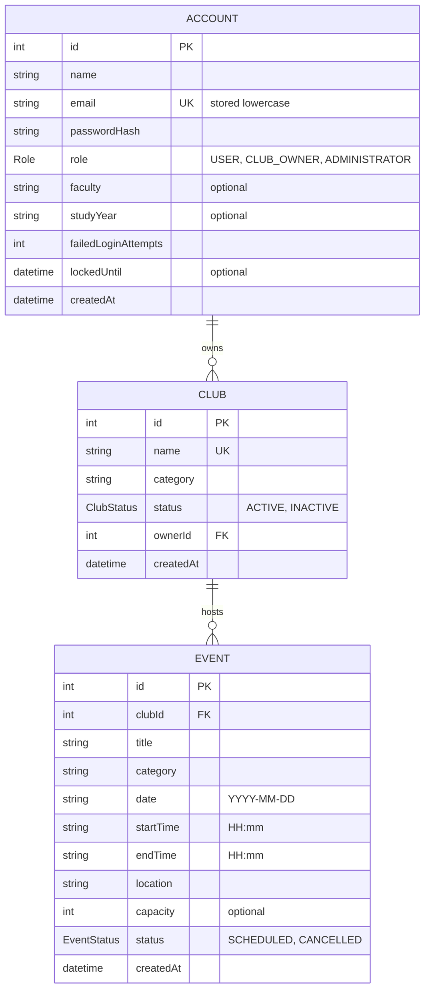

# ClubHouse – Data Model (Sprint A)

## 1. Overview



- One **Account** can own **zero or more Clubs**; each Club has **exactly one owner**. 
- One **Club** hosts **zero or more Events**; each Event belongs to **exactly one Club**. 

---

## 2. Entities

### 2.1 Account

| Field | Type | Required | Rule |
|---|---|---|---|
| id | int | auto | primary key | 
| name | string | yes | not empty → else `Name is required` | 
| email | string | yes | unique, trimmed and lowercased; domain `mail.mcgill.ca` or `mcgill.ca` → else `Invalid McGill email`; empty → `Email is required`; already used → `Email already registered` | 
| passwordHash | string | yes | never store the plain password (bcrypt). Empty → `Password is required`; weak → `Password too weak` | 
| role | Role | yes | `USER` at creation; becomes `CLUB_OWNER` when assigned a club | 
| faculty | string | no | free text, e.g. "Engineering" | 
| studyYear | string | no | e.g. "U2" | 
| failedLoginAttempts | int | yes | default 0 | 
| lockedUntil | datetime | no | set when the account is locked | 
| createdAt | datetime | auto | – | 

### 2.2 Club

| Field | Type | Required | Rule |
|---|---|---|---|
| id | int | auto | primary key | 
| name | string | yes | not empty → `Club name is required`; unique (case-insensitive, D6) → `Club name already exists` | 
| category | string | yes | not empty → `Category is required`; must be in the shared category list (D7) | 
| status | ClubStatus | yes | `ACTIVE` at creation; `INACTIVE` clubs are hidden from browsing | 
| ownerId | int → Account | yes | must be an existing account → else `Owner account not found` | 
| createdAt | datetime | auto | – | 

### 2.3 Event

| Field | Type | Required | Rule | 
|---|---|---|---|
| id | int | auto | primary key | 
| clubId | int → Club | yes | the club the event belongs to | 
| title | string | yes | not empty → `Title is required` | 
| category | string | yes | not empty → `Category is required`; shared category list (D7) | 
| date | string `YYYY-MM-DD` | yes | not before today → else `Event date cannot be past` (D9) | 
| startTime | string `HH:mm` | yes | 24-hour clock | 
| endTime | string `HH:mm` | yes | strictly after startTime → else `End time must be after start` | 
| location | string | yes | free text, e.g. "McConnell 103" (no error scenario yet, see open question Q3) | 
| capacity | int | no | positive integer when set | ID_015 alternate flow |
| status | EventStatus | yes | `SCHEDULED` at creation; `CANCELLED` reserved for the future "cancel event" story | 
| createdAt | datetime | auto | – | 

---

## 3. Roles and permissions

| Action | User | Club Owner | Administrator | Not logged in | Error message | 
|---|---|---|---|---|---|
| Create account | – | – | – | ✅ | – | 
| Log in | ✅ | ✅ | ✅ | – | – | 
| Browse clubs | ✅ | ✅ | ✅ | ❌ | `Login required` | 
| Create club | ❌ | ❌ | ✅ | ❌ | `Unauthorized user` | 
| Create event for club X | ❌ | ✅ **only if owner of X** | ❌ | ❌ | `Unauthorized user` | 

Permission checks look at **who the actor is**, not only the role: owning *a* club does not let you create events for *another* club.

---

## 4. Prisma schema 

```prisma
generator client {
  provider = "prisma-client-js"
}

datasource db {
  provider = "sqlite"
}

enum Role {
  USER
  CLUB_OWNER
  ADMINISTRATOR
}

enum ClubStatus {
  ACTIVE
  INACTIVE
}

enum EventStatus {
  SCHEDULED
  CANCELLED
}

model Account {
  id                  Int       @id @default(autoincrement())
  name                String
  email               String    @unique // always stored lowercase
  passwordHash        String
  role                Role      @default(USER)
  faculty             String?
  studyYear           String?
  failedLoginAttempts Int       @default(0)
  lockedUntil         DateTime?
  createdAt           DateTime  @default(now())

  ownedClubs Club[] @relation("ClubOwner")
}

model Club {
  id        Int        @id @default(autoincrement())
  name      String     @unique
  category  String
  status    ClubStatus @default(ACTIVE)
  ownerId   Int
  createdAt DateTime   @default(now())

  owner  Account @relation("ClubOwner", fields: [ownerId], references: [id])
  events Event[]

  @@index([ownerId])
}

model Event {
  id        Int         @id @default(autoincrement())
  clubId    Int
  title     String
  category  String
  date      String // "YYYY-MM-DD", Montreal local date
  startTime String // "HH:mm", 24 h
  endTime   String // "HH:mm", 24 h, must be after startTime
  location  String
  capacity  Int?
  status    EventStatus @default(SCHEDULED)
  createdAt DateTime    @default(now())

  club Club @relation(fields: [clubId], references: [id], onDelete: Cascade)

  @@index([clubId, date])
}
```
